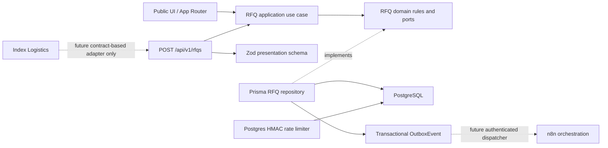

# Initial technical assessment and implementation plan

**Project:** Leopard International Shipping  
**Date:** 2026-10-21  
**Initial repository audit:** Workspace was empty; there was no existing application to preserve or rewrite.  
**Evidence limitation:** None of the four named handover/blueprint documents appeared in the workspace. This assessment does not claim to have read them. All business assertions below are traceable only to the supplied master prompt until those files are provided.

## 1. Executive technical assessment

Leopard should begin with a conversion-focused public website and a controlled freight RFQ intake—not a marketplace, automatic quoting engine or broad TMS. A modular monolith is appropriate: the public experience, request workflow and future private operations can share one application and authoritative Leopard PostgreSQL database while keeping domain rules independent of Next.js, Prisma and n8n.

The customer journey is the first business-critical slice: public page → validated structured RFQ → unique Leopard reference → company/contact identity resolution → initial status-history entry → transactional outbox event → human follow-up. No customer-facing rate or binding offer is generated. Quote approval, CRM, agent management, Feed Hub transactions, Academy CMS and shipment execution are future modules.

**MVP implementation created in this workspace:** Next.js App Router + strict TypeScript, Arabic/English locale routes, responsive corporate site, RFQ multi-step UI, Zod validation, PostgreSQL/Prisma schema and repository port, unique-reference use case, DB-backed HMAC-keyed RFQ rate-limit buckets, idempotency support, status-transition rules, initial tests, `sitemap.xml`/`robots.txt`, and owner-facing architecture/security documents.

**Owner-supplied updates received after the initial repository audit:** Leopard logo artwork and a promotional banner were provided, together with `wael.elewa71@gmail.com`, phone `01001753684` and the banner's `leopardlogistics.com` address; the YouTube channel `https://www.youtube.com/@waelelewa4660` and Google Drive e-book folder were also supplied. These links and contact values are integrated as owner-provided inputs, not independently verified; Drive folder permissions have not been checked. Draft Arabic/English vision, mission and goal statements have been added for owner review.

**Still not launch-ready:** The four named source documents, legal/privacy approval, database credentials, email provider, verified Index Logistics URL/API contract, office address, content/asset rights confirmation and hosting-account authorization remain outstanding. The RFQ API deliberately fails closed unless database/rate-limit configuration and `PRIVACY_NOTICE_APPROVED=true` are present. No migration has been applied and no public deployment was attempted.

## 2. Requirements traceability matrix

The full row-level matrix is in [requirements-traceability.md](./requirements-traceability.md). The key classification is:

| Category                                        | Summary                                                                                                                                                                                | Implementation boundary                                                                                                                                    |
| ----------------------------------------------- | -------------------------------------------------------------------------------------------------------------------------------------------------------------------------------------- | ---------------------------------------------------------------------------------------------------------------------------------------------------------- |
| Prompt-confirmed Leopard requirements           | Lead generation; freight service descriptions; structured RFQs; one master-company identity; human-controlled commercial offers; privacy/security; optional Feed Hub; Academy content. | Public site/RFQ foundation now; all private operations remain future work. These points are not independently confirmed against missing Leopard documents. |
| Prompt-confirmed Index integration requirements | Separate Index platform; no marketplace recreation; no leakage of Leopard CRM, rates, margin or agent history; authenticated explicit contracts for future sharing.                    | Explanatory section only; no Index API or assumed legal/business equivalence. These points come from the supplied prompt only.                             |
| Future phase                                    | Private CRM/RBAC, agent outreach, quotes/rates, shipment operations, Feed Hub listings/matching, CMS/Academy, n8n, calculators, full audit and document management.                    | Documented and intentionally not represented as live.                                                                                                      |
| Technical recommendations                       | Modular monolith, Clean Architecture direction, PostgreSQL/Prisma, Zod, Outbox, idempotency, state transitions, server rendering, locale routes.                                       | Implemented where needed for the initial RFQ slice; avoid unused abstraction layers.                                                                       |
| Owner confirmation                              | Source documents, legal/service scope, brand, domain/contact, policies, hosting/data residency, approved workflows, Index/Academy URLs, commercial authority.                          | Explicit launch gates in the traceability matrix.                                                                                                          |

## 3. Recommended system architecture

### Deployment shape

- One TypeScript/Next.js modular monolith, deployed as a Node.js web application.
- One authoritative Leopard PostgreSQL database for operational records.
- Prisma as persistence adapter; no browser-to-database access.
- Outbox rows are committed in the same transaction as the RFQ. A future worker/adapter delivers approved events to n8n/email; n8n does not own the business record.
- Separate Index Logistics remains a separate bounded platform and database. Any integration is via a new documented, authenticated, least-privilege adapter.
- No microservices, Redis, Kafka, Kubernetes or paid AI service in this MVP.

### Clean Architecture layers

| Layer          | Responsibility                                                                                    | Current examples                                             |
| -------------- | ------------------------------------------------------------------------------------------------- | ------------------------------------------------------------ |
| Presentation   | App Router pages, accessible UI, API serialization, locale dictionary and Zod request schema.     | `apps/web/src/app`, `components`, `modules/rfq/presentation` |
| Application    | Orchestrate use cases and inject ports.                                                           | `modules/rfq/application/create-rfq.ts`                      |
| Domain         | RFQ status transition rules, identity normalization, repository contract, request business types. | `modules/rfq/domain`                                         |
| Infrastructure | Prisma adapter, Postgres rate-limit adapter, future provider/n8n/email adapters.                  | `modules/rfq/infrastructure`                                 |
| Persistence    | PostgreSQL schema, constraints, migration history.                                                | `packages/database/prisma`                                   |
| Integration    | Transactional outbox and later explicit API/webhook adapters.                                     | `OutboxEvent`; dispatcher not yet implemented                |

Domain does not import Next.js, Prisma, n8n, React or provider libraries. The web API is the composition root for the initial use case. More explicit composition/dependency injection can be introduced when additional workflows need it.

### Module dependency map



## 4. Proposed database ERD

The ERD was created before the migration artifact. See [database/erd.md](../database/erd.md) for both the implemented RFQ slice and the future logical model.

Core implemented relations:

```text
MasterCompany 1 ── * CompanyContact * ── 1 Contact
MasterCompany 1 ── * Rfq * ── 1 Contact
Rfq 1 ── * CargoItem
Rfq 1 ── * RfqStatusHistory
OutboxEvent (generic aggregate reference; persisted transactionally)
RateLimitBucket (privacy-preserving API abuse control)
```

Important constraints: unique normalized company identity `(normalizedName, countryNormalized)`, unique normalized contact email, unique RFQ reference, unique idempotency key where supplied, UUID primary keys, explicit units and decimal precision, status and creation indexes. The company identity rule is a duplicate-reduction aid; it is not sufficient to merge subsidiaries or related legal entities automatically.

## 5. Technology stack and rationale

| Technology                         | Decision                    | Rationale / status                                                                                                                                                                           |
| ---------------------------------- | --------------------------- | -------------------------------------------------------------------------------------------------------------------------------------------------------------------------------------------- |
| Next.js App Router 16 + React 19   | Use                         | Current stable registry versions at scaffold time; SSR/public pages, route handlers and metadata in one app.                                                                                 |
| TypeScript strict                  | Use                         | Explicit domain and API contracts; no `any` added intentionally.                                                                                                                             |
| PostgreSQL 17+                     | Use                         | Durable authoritative relational store; local Docker compose uses PostgreSQL 17 Alpine.                                                                                                      |
| Prisma ORM 7 + PostgreSQL adapter  | Use                         | Versioned schema, migration history, typed repository implementation. Runtime requires `DATABASE_URL`; no DB was available for migration application.                                        |
| Zod 4                              | Use                         | Shared server-side RFQ validation with mode-dependent rules.                                                                                                                                 |
| React Hook Form + Zod resolver     | Use                         | Multi-step form state and field errors.                                                                                                                                                      |
| Tailwind CSS 4 + custom CSS tokens | Use                         | Tailwind pipeline is available; brand-specific responsive design is implemented with a small semantic CSS layer and design tokens.                                                           |
| next-intl                          | Not added                   | The MVP uses typed locale dictionaries and route segments directly to avoid extra runtime/config complexity. Replace or extend with next-intl if CMS translation workflows make it valuable. |
| Auth.js / RBAC                     | Deferred                    | No private CRM/admin area is implemented in Phase 1/2; authentication should be added with the private operations module, not a decorative login.                                            |
| TanStack Query / Redux / Redis     | Not needed                  | Server Components and a single form submission do not justify these dependencies.                                                                                                            |
| Vitest                             | Use                         | Domain/schema tests are included.                                                                                                                                                            |
| Playwright                         | Planned                     | E2E configuration/test suite can be added after a DB-backed environment and browser runtime are chosen.                                                                                      |
| n8n                                | Planned adapter             | Not activated or credentialed; orchestration begins after the outbox dispatcher and owner-controlled n8n instance exist.                                                                     |
| Docker                             | Use for local Postgres only | Reproducible local database; not a production deployment claim.                                                                                                                              |

Exact dependency versions are captured in `package-lock.json` after installation. No cloud/API account was created and no paid service was activated.

## 6. Repository structure

Current structure follows the requested monorepo layout, with modules added only when code exists:

```text
leopard-platform/
├── apps/web/
│   ├── src/app/[locale]/(public routes)/
│   ├── src/app/api/v1/rfqs/route.ts
│   ├── src/components/{home,layout}/
│   ├── src/i18n/messages.ts
│   ├── src/modules/rfq/{domain,application,infrastructure,presentation}/
│   ├── src/lib/
│   └── tests/
├── packages/database/
│   ├── prisma/schema.prisma
│   ├── prisma/migrations/
│   └── src/client.ts
├── docs/{architecture,api,database,security,deployment}/
├── infrastructure/docker/docker-compose.yml
├── automation/n8n/                 # reserved for approved exportable workflows
├── .env.example
├── prisma.config.ts
└── package.json
```

No admin/CRM folders, sample production records, external credentials or unused microservice packages are created.

## 7. Public website sitemap

### Implemented routes (Arabic and English)

- `/{locale}` — home.
- `/{locale}/about` — company overview with qualified scope and no fabricated history.
- `/{locale}/services` — sea, air, land, customs coordination, import/export, consolidation/warehousing coordination.
- `/{locale}/quote` — multi-step RFQ request.
- `/{locale}/contact` — owner-provided email, phone, website and YouTube channel links; office address remains unprovided.
- `/{locale}/feed-hub` — supplier and potential-importer sections with alfalfa, corn and soybean-meal categories, plus preliminary contact entries transcribed from user-supplied images; entries are explicitly unverified and no transaction/matching functionality is live.
- `/{locale}/academy` — informational page; no unverified channel/content.
- `/{locale}/index-logistics` — separate-platform boundary notice; no invented external URL.
- `/{locale}/privacy`, `/terms`, `/disclaimer` — clearly marked draft legal pages; production RFQ storage is blocked until privacy approval is explicitly configured.
- `/sitemap.xml`, `/robots.txt`, `/` redirects to `/ar`.

### Planned public routes/content

Company Profile download, individual service landing pages, support/complaints, logistics articles/news/customs updates, official resources, Academy courses/lessons, calculators, Feed Hub registration, and French `/fr` are not presented as live. Add them after approved content and operation owners exist.

## 8. UI/UX design system

- Proposed design tokens remain navy `#101C33`, ocean blue `#176B91`, gold `#C7A45A`, off-white `#F6F8FB` and charcoal `#263241`; the owner-supplied logo also contains a burgundy/navy mark. The exact corporate palette still needs owner confirmation.
- Owner-supplied logo and promotional banner are integrated; the responsive header/footer mark is a crop of the supplied logo. Confirm usage rights and approve final brand treatment before launch. The previously generated port hero was removed at the owner’s request; the supplied full-width brand banner is used on the home page instead.
- Arabic is the default locale at `/ar`, with RTL document direction and Arabic dictionary. English is `/en`, LTR. French is not enabled.
- Mobile-first layouts, responsive breakpoint behavior, semantic sections, visible keyboard focus, skip link, labeled form controls, reduced-motion behavior, optimized local WebP image and no external font/image dependency.
- No invented testimonials, partner logos, certifications, operating statistics or years of experience.
- Service availability, partner coverage, licensing, capacity, rates and transit time are qualified and must be confirmed per request.

## 9. API design (MVP)

Contract detail: [api/rfq-contract.md](../api/rfq-contract.md).

### `POST /api/v1/rfqs`

- Same-origin JSON only; 24 KiB maximum body; server-side Zod validation; no file uploads.
- Requires `DATABASE_URL`, `RATE_LIMIT_HMAC_SECRET` (32+ chars), owner-approved `PRIVACY_NOTICE_APPROVED=true`, and trusted proxy IP headers.
- Validates required customer/route/cargo fields, FCL container rule, sea load-type rule, air CBM/dimensions rule, consent, numbers/units and enumerated Incoterms.
- Creates or reuses normalized MasterCompany and Contact, creates RFQ, CargoItem, initial status history and `rfq.created` OutboxEvent in one DB transaction.
- Accepts `Idempotency-Key`; public response contains only `reference`, `status`, `createdAt`.
- 201 success; 400 invalid input; 403 cross-origin; 413 body too large; 415 media type; 429 rate limited; 503 unconfigured/unavailable. No public CRM read/search endpoint.

No prices, margins, supplier rates, internal IDs, CRM notes or agent communications are included in public responses.

## 10. Security architecture

- **Threat boundaries:** unauthenticated RFQ form/API, future uploads, future admin, private agent data and automation callbacks.
- **MVP controls:** input validation on server; database access only server-side; same-origin check when `Origin` exists; size limit; rate-limit buckets keyed with an HMAC of the client address and time window; idempotency; hidden honeypot; parameterized Prisma operations; unique database constraints; outbox transaction; no direct rate or internal field response; no file upload; fail-closed configuration; generic errors with structured non-PII logs.
- **Trusted proxy requirement:** ingress must overwrite `X-Real-IP`/`X-Forwarded-For`; do not expose the app directly to untrusted clients with spoofable forwarding headers. Validate this in the selected hosting environment.
- **Privacy:** data collection is disabled until owner/legal review explicitly flips `PRIVACY_NOTICE_APPROVED=true`. Consent timestamp is recorded. Attribution is not captured. A complete retention, DSAR, backup and deletion plan is still required.
- **Admin authorization:** no private admin route exists in this MVP. Hidden links are not treated as access control. Future CRM endpoints must require server-side role/permission checks and secure sessions.
- **n8n:** no anonymous webhook; use authenticated service identity, allowlisted event types, idempotency, least-privilege credentials, retries, dead-letter/alerting and audit trails.
- **Documents:** secure object storage, content-type/size validation, malware scanning and expiring access are future requirements. No public-directory uploads.
- **Remaining launch controls:** security review, CSRF/ingress behavior test, TLS, CSP/security headers, secret rotation, logging redaction, backups and restore exercise, monitoring, dependency/license review and incident owner.

Detailed scenarios: [security/threat-model.md](../security/threat-model.md).

## 11. n8n integration strategy

n8n is an orchestrator, not the authoritative database. The web transaction writes an outbox event; a future worker claims pending events, sends a signed event with stable `idempotencyKey`, marks delivery/attempt state and retries with bounded backoff. n8n stores only execution metadata and required task state, not a duplicate master customer record.

Initial candidate workflow after approval:

1. Outbox dispatcher → authenticated n8n webhook.
2. Validate signature, schema and idempotency; record run ID in Leopard.
3. Classify/summarize the lead and flag missing information (AI may recommend, never decide commercial terms).
4. Notify authorized human via owner-approved email/CRM task.
5. Human updates RFQ state and quote approval in Leopard.
6. Failure → retry/dead-letter record and alert; never silently drop the inquiry.

Agent follow-up, reply stopping, content approval, publishing and weekly reports remain later workflows. No live workflow, email provider, AI provider, or credential is active.

## 12. Phased implementation plan

| Phase                        | Scope                                                                                       | Exit gate                                                                                                               |
| ---------------------------- | ------------------------------------------------------------------------------------------- | ----------------------------------------------------------------------------------------------------------------------- |
| 0 — Discovery & architecture | Reconcile missing documents, service/legal boundaries, ERD, API, owner decisions.           | Owner signs off traceability and missing-information register.                                                          |
| 1 — Foundation               | Repo, strict TS, design tokens, localization, database schema, local compose, CI and tests. | `npm ci`, lint, typecheck, unit tests, Prisma schema validation and successful migration on a disposable DB.            |
| 2 — Public MVP               | Home/about/services/contact, RFQ form/API, SEO, consent and notification/outbox.            | Critical customer journey passes end-to-end with privacy-approved DB, rate limit, email/outbox and owner copy approval. |
| 3 — CRM foundation           | Auth/RBAC, companies, contacts, leads/RFQs, tasks, dashboard.                               | Authorization tests and internal data privacy review.                                                                   |
| 4 — Feed Hub                 | Supplier/buyer inquiry intake, product taxonomy, matching, source attribution.              | Legal/commercial boundary and transaction-not-guaranteed language approved.                                             |
| 5 — n8n automation           | Intake, email parsing, agent outreach/follow-up, alerts.                                    | Idempotency, reply suppression, unsubscribe/bounce and failure alert tests.                                             |
| 6 — Academy/CMS              | Courses, lessons, video links, content review and publishing queue.                         | Verified official channel and human publishing approval.                                                                |
| 7 — Advanced operations      | Quote sourcing/approval, shipments, milestones, private document management.                | Operations/finance approval matrix, audit, access and retention review.                                                 |
| 8 — Launch/optimization      | Security, accessibility, performance, restore, monitoring, deployment.                      | Measured production checks and owner launch approval; no unverified score claims.                                       |

## 13. MVP acceptance criteria and current status

| Scenario                                                    | Current code status                                                                                          | Verification still needed                                                                 |
| ----------------------------------------------------------- | ------------------------------------------------------------------------------------------------------------ | ----------------------------------------------------------------------------------------- |
| Arabic and English public pages render with correct RTL/LTR | Implemented in routes/layout and dictionaries.                                                               | Browser/e2e review and native business-Arabic review.                                     |
| RFQ required fields/mode conditions                         | Zod schema and tests created.                                                                                | Execute tests and operations review.                                                      |
| Unique RFQ reference                                        | Use case + random reference generation created.                                                              | Integration test against PostgreSQL; collision/idempotency behavior.                      |
| Company duplicate reduction                                 | Composite unique key + upsert + normalization tests.                                                         | Concurrent database test and operations merge policy.                                     |
| RFQ and status history persisted                            | Prisma repository and schema created.                                                                        | Apply migration and API integration test.                                                 |
| RFQ appears in private CRM                                  | Not implemented; no CRM route/dashboard exists.                                                              | Phase 3.                                                                                  |
| Unauthorized users cannot access records                    | No private records endpoint exists.                                                                          | Auth/RBAC tests when private CRM is built.                                                |
| Quote cannot be sent without approval                       | Domain state transitions include approval path; no quote UI exists.                                          | Persistence/service and authorization tests in quote phase.                               |
| Outbox event is atomic with RFQ                             | Transaction code implemented.                                                                                | DB integration test; dispatcher/failure workflow not implemented.                         |
| Rate limit, invalid origin, payload size                    | Handler controls implemented.                                                                                | Test real reverse-proxy header/origin behavior and concurrent requests.                   |
| No internal rates/margins in public response                | Public RFQ response schema only returns reference/status/time.                                               | Add API contract test and privacy/security review.                                        |
| n8n failure logged/escalated                                | Outbox storage only; no consumer/alert yet.                                                                  | Phase 5.                                                                                  |
| Feed Hub uses unified RFQ for freight request               | Intro CTA links to shared RFQ with an allowlisted `feed-hub` source hint; DB integration remains unverified. | Verify source persistence against PostgreSQL and retain it when the full module is built. |
| Secure uploads                                              | No upload accepted.                                                                                          | Design private storage/scanning before enabling.                                          |

The workspace checks must be executed and recorded before stating that any test passed. The source-documents limitation and unconfigured database block end-to-end/business acceptance.

## 14. Monthly operating-cost estimate (planning allowance, not a vendor quote)

Assumptions: low traffic (roughly under 5,000 visits/month), under 500 RFQs/month, one web app, one small PostgreSQL instance, no payments, no paid AI, no document uploads, and no high-availability SLA. Prices vary by provider, region, tax and usage; no service has been activated.

| Item                                            |                                                      Planning allowance | Assumption                                                                                     |
| ----------------------------------------------- | ----------------------------------------------------------------------: | ---------------------------------------------------------------------------------------------- |
| Open-source application, local tools and Docker |                                                                $0/month | No paid account required.                                                                      |
| Domain                                          |                       roughly $12–36/year (about $1–3/month annualized) | Registrar/TLD and renewal price must be confirmed.                                             |
| App hosting                                     |       $0–25/month pilot; budget $20–40/month for a paid production tier | Free tier may have sleep/limits/no SLA.                                                        |
| Managed PostgreSQL                              | $0–25/month pilot; budget $25–60/month for production backups/resources | Free tiers are not a production backup/availability promise.                                   |
| Transactional email                             |                                          $0–10/month at very low volume | Provider and sender-domain verification pending; limits vary.                                  |
| n8n self-hosted compute                         |              $0 license + approximately $5–15/month small VPS allowance | Owner handles patching, backups, monitoring; storage/HA extra. Managed n8n is not priced here. |
| Private object storage                          |            Not required for MVP; $0–10/month low-volume allowance later | Scanning, retention and egress may add costs.                                                  |
| Paid APIs/AI                                    |                                                   $0/month in this plan | No API may be added without owner approval and a separate cost/security comparison.            |

**Indicative total:** $10–50/month for a low-cost pilot plus domain renewal; around $50–140/month for a small, more reliable paid production baseline, excluding owner/staff time, taxes, email overages, disaster recovery, premium support and high availability. These are budget ranges only, not current supplier quotes; re-price once region, provider and data residency are chosen.

## 15. Missing information and external dependencies

Blocking owner decisions are listed as M-01 to M-10 in the traceability matrix. Highest priority before public launch:

1. Upload the four missing source documents and reconcile differences, especially Leopard operating architecture vs. separate Index boundaries.
2. Confirm the supplied logo/banner and usage rights; approve colors, Company Profile, legal entity name, service scope, licensing/partner wording, authorized claims and the draft vision/mission/goal copy.
3. Supply official domain, email, phone, office address, WhatsApp/support path and a verified sender domain.
4. Obtain legal approval for privacy notice, terms, disclaimers, consent, data retention, cross-border processing and document handling; then deliberately enable live collection.
5. Choose owner-controlled hosting, PostgreSQL region, backup/restore objectives, monitoring, trusted ingress and account access.
6. Define quote approval roles, currencies, commercial terms, source-rate handling, credit authority and customer-facing quote template.
7. Supply verified Index URL/API/data-sharing contract and official Academy channel URL/content permissions.
8. Approve Feed Hub supplier/buyer criteria, quality/document verification, target markets and legal/transaction boundaries.
9. Choose n8n hosting and email provider only after cost/retention/credential review; configure owner-controlled incident contacts.
10. Confirm whether campaign attribution can be collected and under what consent; current implementation does not collect it.
