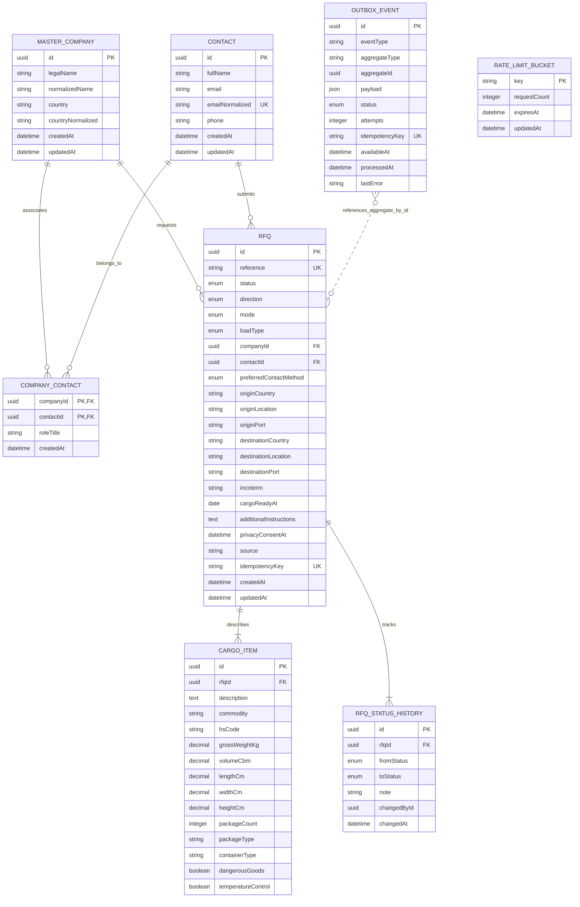

# Database model — ERD before migration

**Status:** conceptual target ERD plus implemented public-RFQ slice. This document is the design artifact that precedes and governs the initial database migration. The actual Prisma schema intentionally contains only the public RFQ slice; future CRM/operations entities are not created as empty placeholder tables.

## MVP ERD (implemented in Prisma schema)

`OutboxEvent.aggregateId` is a typed UUID reference but deliberately has no direct FK to `Rfq`; the table is designed for generic event aggregates in future modules. The application writes the RFQ and `rfq.created` event in one PostgreSQL transaction. A dispatcher is not yet implemented.

## Target logical ERD (future phases; not yet migrated)

The following relationships are a design target only. They will be refined as each module is approved; none of these future tables is created in the current Prisma migration.

```mermaid
erDiagram
  USER ||--o{ USER_ROLE : assigned
  ROLE ||--o{ USER_ROLE : grants
  ROLE ||--o{ ROLE_PERMISSION : contains
  PERMISSION ||--o{ ROLE_PERMISSION : permits
  MASTER_COMPANY ||--o{ COMPANY_CONTACT : associates
  CONTACT ||--o{ COMPANY_CONTACT : belongs_to
  MASTER_COMPANY ||--o{ CUSTOMER_PROFILE : has_role
  MASTER_COMPANY ||--o{ AGENT_PROFILE : has_role
  MASTER_COMPANY ||--o{ SUPPLIER_PROFILE : has_role
  MASTER_COMPANY ||--o{ LEAD : originates
  MASTER_COMPANY ||--o{ OPPORTUNITY : develops
  RFQ ||--o{ SOURCED_RATE : receives
  RFQ ||--o{ QUOTE : produces
  QUOTE ||--o{ QUOTE_APPROVAL : requires
  QUOTE ||--o| SHIPMENT : may_convert_to
  SHIPMENT ||--o{ SHIPMENT_MILESTONE : tracks
  SHIPMENT ||--o{ SHIPMENT_DOCUMENT : stores
  MASTER_COMPANY ||--o{ SUPPLIER_LISTING : offers
  MASTER_COMPANY ||--o{ BUYER_REQUIREMENT : requests
  SUPPLIER_LISTING ||--o{ MATCHMAKING_INQUIRY : matched
  BUYER_REQUIREMENT ||--o{ MATCHMAKING_INQUIRY : matched
  COURSE ||--o{ LESSON : contains
  PAGE ||--o{ ARTICLE : publishes
  USER ||--o{ TASK : assigned
  USER ||--o{ NOTIFICATION : receives
  USER ||--o{ AUDIT_LOG : acts
  OUTBOX_EVENT ||--o{ AUTOMATION_RUN : delivered_as
```

Target entity groups include identity (`User`, `Role`, `Permission`, sessions), CRM (`MasterCompany`, `Contact`, role profiles, `Lead`, `Opportunity`), freight (`RFQ`, sourced rates, quotes, approvals, shipments, milestones, documents), Feed Hub (`FeedProduct`, supplier listings, buyer requirements, matchmaking inquiries), content (`Page`, `Article`, `Course`, `Lesson`, media), and operations (`Task`, `Notification`, `AuditLog`, `AutomationRun`, `OutboxEvent`). Entity fields, retention, access and constraints are subject to phase-specific review; see the implementation brief and traceability matrix.

## Integrity and data decisions

- UUID keys and explicit foreign keys; unique public RFQ reference and optional idempotency key.
- Master company identity is `(normalizedName, countryNormalized)` in the initial slice. This is a duplicate-reduction rule, not proof two legal entities are identical. Operations need a later merge/review workflow for false positives and subsidiaries.
- Contact identity is normalized email. A `CompanyContact` join allows the same contact to be associated with multiple companies without copying contact records.
- Each initial RFQ creates one `CargoItem`. The relation is one-to-many so a later UI can support multi-line cargo without redesigning the aggregate.
- Weight/volume/dimensions are stored in explicit units and decimal precision; no live rate, financial quote or price is stored in the public RFQ slice.
- Consent timestamp is stored with the RFQ. Analytics attribution and document uploads are not collected until consent wording and secure storage/retention rules are approved.
- Do not expose `OutboxEvent`, rate-limit keys, normalized identity values, database IDs or operational status history through a public read API.
- Sensitive documents must use private object storage with scoped access, malware scanning, expiry/retention and audit logging; public filesystem storage is prohibited.

## Migration status

- Prisma schema location: `packages/database/prisma/schema.prisma`.
- The model is designed; migration application requires an owner-managed PostgreSQL connection.
- No production migration has been applied and no real business records have been seeded.
